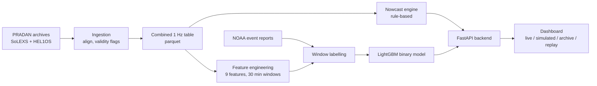

# Knoxis

**Solar flare nowcasting and 60-minute forecasting from real Aditya-L1 data.**

Knoxis combines the soft X-ray instrument **SoLEXS** and the hard X-ray instrument **HEL1OS** on ISRO's Aditya-L1 mission to do two things:

1. **Nowcast**: detect a solar flare that is already in progress, estimate its GOES-equivalent class (for example `M6.8`), and raise a graduated `QUIET / WATCH / WARNING / ALERT` signal.
2. **Forecast**: estimate the probability that a flare will begin within the next 60 minutes.

Both engines run on the same processed data and are served by a FastAPI backend and a single-file web dashboard, which includes a replay mode that re-runs the system as if only data up to a chosen moment existed.

> Knoxis is a B.Tech mini-project (CSE-AI, Pranveer Singh Institute of Technology, Kanpur). It is a research and teaching system, **not** an operational space-weather service. See [Limitations](#limitations).

---

## Results at a glance

| | |
|---|---|
| Data | 787 of 913 days (Feb 2024 to Aug 2026) ingested; 226,656 labelled 30-minute windows |
| Nowcast | Reproduced both calibration flares of 21 June 2026 with the classes NOAA reports independently (M2.6 and M6.8) |
| Forecast target | Binary: flare / no flare in the next 60 minutes |
| Forecast skill | ROC-AUC 0.592, PR-AUC 0.389 against a no-skill baseline of 0.301 (lift about 1.29) on a held-out, chronologically later test set |
| Not achieved | 5-class severity prediction (QUIET/B/C/M/X) had near-chance skill, so it was dropped, and the negative result is documented |

The forecast has **modest but real** skill. Read its output as a ranking of risk, not as a calibrated probability.

---

## How it works



### Ingestion (`ingestion/`)
Turns raw FITS files into one clean 1 Hz table indexed by UTC timestamp.

- Fixes FITS big-endian arrays that NumPy 2.x refuses to process.
- SoLEXS: uses the GTI (Good Time Interval) file to flag valid samples. Gaps are **never interpolated**.
- HEL1OS: converts MJD to UTC, cross-checks it against the ISOT string, and merges multi-file dumps of the same day (`load_helios_multi`).
- Aligns HEL1OS onto the SoLEXS time grid with a nearest-timestamp `merge_asof` (default tolerance `2s`).

Design reasoning and the bugs found along the way are in [`ingestion/README.md`](ingestion/README.md).

### Nowcast engine (`nowcast/`)
A deliberately simple, explainable, causal detector. Defaults live in `NowcastConfig`.

| Step | Behaviour |
|---|---|
| Baseline | Trailing 24 h rolling median of GTI-valid SoLEXS counts (needs at least 1 h of valid samples). Trailing only, so no future leakage |
| Trigger | Flux above `1.4 x` baseline |
| Confirmation | Trigger must be sustained for `3` minutes before an `ALERT` is confirmed |
| Early levels | `WATCH` starts 60% of the way to the threshold and `WARNING` at 85% (a design choice, not empirically derived) |
| Classification | Peak counts/s are converted to GOES-equivalent flux with `1.379e-8 W/m² per count/s` |
| HEL1OS | Used only as non-blocking corroboration (`yes / no / inconclusive`), never as a gate, because HEL1OS drops to zero during extreme flares |

The conversion factor was derived from two NOAA-confirmed flares (M2.6 at 1,886 counts/s and M6.8 at 4,931 counts/s). Treat the calibration as strong but provisional evidence, since it rests on only two events. Details: [`nowcast/README.md`](nowcast/README.md).

### Forecast (`forecast/`)
- **Features** (9, computed over 30-minute windows stepped every 5 minutes): `solexs_mean`, `solexs_slope`, `solexs_std`, `hel1os_mean`, `hel1os_slope`, `hardness_ratio`, `hr_rate_of_change`, `peak_to_mean_ratio`, `hel1os_saturation_fraction`.
- **HEL1OS saturation** (zero counts during intense flux) is detected and masked so the model does not learn "near-zero HEL1OS means quiet".
- **Labels**: for each window, the strongest NOAA flare that *begins* in the next 60 minutes. The labels are class-imbalanced (the 5-class table is about 167:1 at its worst).
- **Model**: LightGBM, `class_weight="balanced"`, chronological train/test split.
- **Alert levels**: the probability is mapped to `QUIET / WATCH / WARNING / ALERT` with thresholds that default to `0.3 / 0.5 / 0.7`. They can be overridden through `model_meta.json` or environment variables.

How the binary framing was reached (five failed hypotheses on 5-class severity) is documented in [`forecast/README.md`](forecast/README.md) and in the project report.

### Replay is causal by design
Every rolling computation is trailing, so truncating the data at time *T* gives the same result as reading the full run at *T*. The API checks this at startup (`verify_causality`) and then serves replay positions by cheap slicing. If the check fails, it falls back to re-running the engine on truncated data for every position.

---

## Repository layout

```
knoxis/
├── README.md
├── Knoxis_Mini_Project_Report.pdf
├── pyproject.toml                  packages the ingestion module (name: knoxis)
├── requirements.txt
│
├── api/                            FastAPI backend (run from the repo root)
│   ├── main.py                     app, startup/shutdown lifespan, CORS
│   ├── routes.py                   all HTTP endpoints (thin: parse params, call a service)
│   ├── schemas.py                  Pydantic response models
│   ├── config.py                   settings and constants, overridable via KNOXIS_* env vars
│   ├── state.py                    nowcast engine, model and metadata, loaded once at startup
│   ├── snapshot.py                 data loading, snapshot cache, background "latest" keeper,
│   │                               as_of replay (slice vs exact) and the causality self-check
│   ├── daystore.py                 multi-day parquet archive behind the date selector (no database)
│   ├── timeutil.py                 UTC / epoch / NaN-to-None helpers
│   ├── live_feed_simulator.py      replays a historical day into the "live" file for demos
│   └── services/
│       ├── __init__.py
│       ├── nowcast.py              current alert level, flux, baseline, GOES-equivalent class
│       ├── forecast.py             model probability to graduated level
│       ├── history.py              detected-flare table
│       ├── timeseries.py           downsampled series and levels for the chart
│       ├── health.py               data-health numbers and live/simulated/archive mode detection
│       ├── evaluation.py           detection stats, hit rate / false alarms / latency vs a truth file
│       └── diagnostics.py          configuration checklist with a fix hint per failure
│
├── dashboard/
│   └── index.html                  single-file dashboard (light + dark theme), served by the API at "/"
│
├── ingestion/                      FITS loaders and the SoLEXS + HEL1OS alignment pipeline
│   ├── __init__.py
│   ├── data_ingestion.py           load_solexs, load_helios, load_helios_multi, DataIngestionPipeline
│   ├── README.md                   design notes and the bugs found along the way
│   └── test.ipynb                  exploratory notebook
│
├── nowcast/                        rule-based nowcast engine
│   ├── __init__.py
│   ├── nowcast.py                  NowcastConfig, NowcastEngine, GOES-equivalent classification
│   └── README.md
│
├── forecast/
│   ├── README.md
│   ├── pipeline/                   data preparation, features, labelling, validation, serving helpers
│   │   ├── noaa_fast.py            concurrent, resumable NOAA event-report downloader
│   │   ├── parse_noaa.py           NOAA reports to a flare catalog (XRA events only)
│   │   ├── solexs_extract.py       extracts SDD2 light curves and GTI files from PRADAN zips
│   │   ├── extract_hel1os.py       HEL1OS dump resolver, extraction only (earlier version of manage_helios_dumps.py)
│   │   ├── manage_helios_dumps.py  resolves overlapping HEL1OS dumps and merges them to one parquet per day
│   │   ├── combine_day.py          aligns one day of SoLEXS with merged HEL1OS
│   │   ├── compute_features.py     the 9 rolling-window features, with HEL1OS saturation masking
│   │   ├── label_windows.py        labels each window with the strongest flare in the next 60 min
│   │   ├── build_master_table.py   concatenates labelled days into one training table
│   │   ├── sanity_check_labeled.py     integrity checks on the labelled dataset
│   │   ├── final_validation_suite.py   random flare sample and feature sanity checks
│   │   ├── forecast_alert.py       probability thresholds to WATCH / WARNING / ALERT
│   │   ├── ingest_new_day.py       one command to add a newly downloaded day to the live file
│   │   └── simulate_live_playback.py   checks that batch and incremental computation agree
│   ├── archieve/                   model training scripts (folder name spelled this way in the repo)
│   │   ├── train_binary_flare_model.py   current model: binary flare / no flare, LightGBM
│   │   ├── tune_binary_flare_model.py    randomised hyperparameter search for the binary model
│   │   ├── train_model.py                superseded: original 5-class Random Forest
│   │   ├── train_gbm_model.py            superseded: 5-class LightGBM
│   │   └── train_two_stage_model.py      superseded: two-stage detection then severity
│   └── investigation/              diagnostics from the model-development investigation
│       ├── check_signal_exists.py
│       ├── diagnostic_within_period_split.py   covariate-shift control test
│       ├── validate_solexs_completeness.py
│       ├── validate_gti_completeness_full_dataset.py
│       ├── check_gti_validity_for_flagged_days.py
│       └── check_monthly_17th_pattern.py
│
└── notebooks/                      early exploratory work
    ├── ingestion.py                first SoLEXS + HEL1OS merge script
    └── config.txt                  example input file list
```

`data/` (raw archives, intermediate parquet files, trained model) is not part of the repository and must be created locally.

---

## Quick start

### 1. Install

Python 3.10 or newer.

```bash
python -m venv .venv
source .venv/bin/activate          # Windows: .venv\Scripts\activate

pip install numpy pandas astropy pyarrow scikit-learn lightgbm scipy joblib \
            requests fastapi "uvicorn[standard]" pydantic
```

> `requirements.txt` currently lists only `numpy`, `pandas`, `astropy` and `pyarrow`, which is enough for the ingestion module. The command above covers everything else used by the pipeline and API.

### 2. Provide data

The API reads a **parquet file indexed by UTC `timestamp`** at 1 Hz with these columns:

| Column | Meaning |
|---|---|
| `solexs_counts` | SoLEXS counts/s |
| `solexs_is_valid` | GTI-valid flag |
| `hel1os_ctr` | HEL1OS CZT1 counts/s |
| `hel1os_is_valid` | HEL1OS validity flag |
| `hel1os_err` | HEL1OS count error (used for saturation detection in the forecast features) |

This is the output of the ingestion pipeline (see [Building the dataset](#building-the-dataset-and-model-from-scratch)). By default the API looks for:

```
data/training/output/latest_data.parquet      # the "live" file
data/days/*.parquet                           # optional archive for the date selector
```

### 3. Run

From the **repository root**:

```bash
python -m uvicorn api.main:app --port 8000
```

Open <http://127.0.0.1:8000>. The API serves the dashboard itself, so there is no second server and no CORS setup. Open `/docs` for the interactive API reference, or click **Run checks** in the dashboard's Diagnostics panel to see what is configured and what is missing.

The nowcast works as soon as a data file exists. The **forecast panel shows "not loaded"** until a trained model is available (see below).

### 4. Demo a live feed (optional)

No public API exists for PRADAN, so data arrives by manual download. To see the dashboard behave like a live system, replay a real historical day into the "live" file:

```bash
python -m api.live_feed_simulator \
    --source-file data/june21_with_leadin.parquet \
    --output-file data/training/output/latest_data.parquet \
    --leadin-hours 24 --step-minutes 5 --interval-seconds 3
```

The source must span at least `leadin-hours` plus some time to advance, because the nowcast baseline needs a 24 h lead-in. The writer replaces the file atomically, so the API never reads a half-written file.

---

## Dashboard

- **Data selector**: live feed or any archived UTC day found in `data/days/`.
- **Replay**: play or scrub through a day. Each position re-runs the system on data up to that time only.
- **Flux timeline**: SoLEXS flux (log axis) with baseline, alert threshold, an alert-level strip, detection markers and indicative C1/M1/X1 guides. A synchronised HEL1OS panel can be toggled.
- **Status panels**: nowcast level, flux over baseline, GOES-equivalent class, sustain progress, forecast probability against the base rate.
- **Detected flares table**, **data-health** panel, **evaluation** panel and **diagnostics**.
- **Light/dark theme** toggle in the header (follows the OS setting until you choose; the choice is remembered in `localStorage`).

If the API runs elsewhere, open the page with `?api=http://host:port`. Opening `?day=YYYY-MM-DD` selects an archived day.

---

## API reference

All endpoints are `GET`. Most accept `day=YYYY-MM-DD` (archived day) and `as_of=<ISO timestamp>` (causal replay).

| Endpoint | Purpose |
|---|---|
| `/` | Serves the dashboard |
| `/health` | Liveness; whether the model and data file are available |
| `/status` | Combined nowcast, forecast, data health and replay span, which is what the dashboard polls |
| `/nowcast` | Current alert level, flux, baseline, ratio, GOES-equivalent class |
| `/forecast` | Flare probability, base rate, level and thresholds |
| `/flare-history` | Detected flare events (`max_events`, default 10) |
| `/timeseries` | Downsampled flux, baseline, levels and HEL1OS (`start`, `end`, `max_points`) |
| `/days` | Archived days and whether a live file exists |
| `/evaluation` | Detection statistics, and hit rate, false alarms and latency if a truth file is provided |
| `/metrics` | Contents of an offline `metrics.json`, if present |
| `/diagnostics` | Checklist of what is configured and a hint for each failure |

```bash
curl "http://127.0.0.1:8000/status"
curl "http://127.0.0.1:8000/flare-history?day=2026-06-21"
curl "http://127.0.0.1:8000/nowcast?day=2026-06-21&as_of=2026-06-21T19:30:00Z"
```

---

## Configuration

All settings are environment variables (see `api/config.py`).

| Variable | Default | Purpose |
|---|---|---|
| `KNOXIS_DATA_FILE` | `data/training/output/latest_data.parquet` | The live data file |
| `KNOXIS_DAYS_DIR` | `data/days` | Folder of parquet files for the date selector |
| `KNOXIS_MODEL_FILE` | `data/training/output/knoxis_binary_flare_model.joblib` | Trained forecast model |
| `KNOXIS_META_FILE` | `model_meta.json` next to the model | Model version, base rate, thresholds |
| `KNOXIS_METRICS_FILE` | `data/training/output/metrics.json` | Optional offline evaluation results |
| `KNOXIS_TRUTH_FILE` | `data/truth/noaa_events.csv` | Optional ground truth (`start_time`, `peak_time`, `end_time`, `goes_class`) |
| `KNOXIS_THRESHOLD_RATIO` | `1.4` | Display only; must match `NowcastConfig` |
| `KNOXIS_SUSTAIN_MINUTES` | `3` | Display only; must match `NowcastConfig` |
| `KNOXIS_GOES_FACTOR` | `1.379e-8` | Display only; must match the nowcast calibration |
| `KNOXIS_WATCH_THRESHOLD`, `_WARNING_`, `_ALERT_` | `0.3 / 0.5 / 0.7` | Forecast level cutoffs |
| `KNOXIS_LEADIN_HOURS` | `24` | History loaded before a selected day so the baseline is warm at 00:00 |
| `KNOXIS_REPLAY` | `auto` | `exact`, `slice` or `auto` replay strategy |
| `KNOXIS_MODE` | unset | Force `live`, `simulated` or `replay` labelling |
| `KNOXIS_DASHBOARD_FILE` | `dashboard/index.html` | Dashboard to serve |

`model_meta.json` is a small JSON file:

```json
{
  "model_version": "binary-lgbm-v1",
  "base_rate": 0.301,
  "thresholds": { "watch": 0.3, "warning": 0.5, "alert": 0.7 }
}
```

Without it the API still runs, using default thresholds and showing no base rate.

---

## Building the dataset and model from scratch

Everything below runs from the repository root. Paths are examples. The scripts expect the PRADAN download layout (`level1/YYYY/MM/DD/...`).

```bash
# 1. Ground truth: download and parse NOAA daily event reports
python forecast/pipeline/noaa_fast.py   --start 2024-02-01 --end 2026-08-01 --out-dir data/noaa_events
python forecast/pipeline/parse_noaa.py  --events-dir data/noaa_events --start 2024-02-01 --end 2026-08-01 --out data/flare_catalog.parquet

# 2. SoLEXS: extract SDD2 light curves and GTI files from the PRADAN zips
#    (edit SOURCE_ROOT and OUTPUT_ROOT at the top of the script first)
python forecast/pipeline/solexs_extract.py

# 3. HEL1OS: resolve overlapping dumps and merge to one parquet per day
python forecast/pipeline/manage_helios_dumps.py --download-root <pradan_root> --output-root data/helios_merged

# 4. Combine SoLEXS + HEL1OS per day
python forecast/pipeline/combine_day.py --solexs-dir data/solexs_sdd2 --helios-merged-dir data/helios_merged \
       --output-dir data/combined --start 2024-02-01 --end 2026-08-01

# 5. Features, labels, master table
python forecast/pipeline/compute_features.py --combined-dir data/combined --output-dir data/features --window-minutes 30 --step-minutes 5
python forecast/pipeline/label_windows.py    --features-dir data/features --flare-catalog data/flare_catalog.parquet --output-dir data/labeled --horizon-minutes 60
python forecast/pipeline/build_master_table.py --labeled-dir data/labeled --output data/master_training_table.parquet

# 6. Validate the dataset (optional but recommended)
python forecast/pipeline/sanity_check_labeled.py     --labeled-dir data/labeled --flare-catalog data/flare_catalog.parquet
python forecast/pipeline/final_validation_suite.py   --master-table data/master_training_table.parquet --flare-catalog data/flare_catalog.parquet

# 7. Train the binary model (or the tuned variant)
python forecast/archieve/train_binary_flare_model.py --master-table data/master_training_table.parquet \
       --model-output data/training/output/knoxis_binary_flare_model.joblib
python forecast/archieve/tune_binary_flare_model.py  --master-table data/master_training_table.parquet --n-iter 20

# 8. Choose alert thresholds from the precision-recall table, then write model_meta.json
python forecast/pipeline/forecast_alert.py --model data/training/output/knoxis_binary_flare_model.joblib \
       --master-table data/master_training_table.parquet --suggest-thresholds
```

Two scripts use paths relative to the working directory, so run them from the folder noted in their docstrings if imports fail: `combine_day.py` and `manage_helios_dumps.py` add the repository root to `sys.path` based on the current directory.

### Adding a new real day
`forecast/pipeline/ingest_new_day.py` turns "I just downloaded a new day from PRADAN" into one command that refreshes the live file the API reads:

```bash
python forecast/pipeline/ingest_new_day.py --helios-zip-dir <dir_with_hel1os_zips> \
       --solexs-lc <day.lc> --solexs-gti <day.gti> \
       --live-data-file data/training/output/latest_data.parquet --day 20260621
```

### Verifying live-safety
`forecast/pipeline/simulate_live_playback.py` checks the causality claim directly: it truncates a real day at several checkpoints, recomputes everything, and compares against the full-day result.

---

## Data sources

- **Aditya-L1 SoLEXS and HEL1OS** (Level-1) from ISRO's [PRADAN portal](https://pradan.issdc.gov.in/). Access needs an account, and there is no public polling API, so downloads are manual.
- **NOAA Solar Event Reports**, used as ground truth, from NCEI's [space weather archive](https://www.ngdc.noaa.gov/stp/space-weather/swpc-products/daily_reports/solar_event_reports/).

---

## Instrument notes worth knowing

- **HEL1OS is about 75 to 81% exact-zero at 1 s resolution.** This is a real instrument trait, not missing data, so HEL1OS comparisons use summed windows rather than medians of per-second counts.
- **Synchronised CZT1/CZT2 zero-dropout is real**, and CZT1 appears to saturate during extreme flares (confirmed on the 12 Feb 2024 M6 and 21 Jun 2026 M6.8 flares). Saturated windows are masked in the features.
- **SoLEXS NaNs mean something.** They coincide with GTI gaps, so they are flagged rather than filled.
- A recurring low (about 16.7%) GTI validity on the 17th of each month is plausibly a monthly calibration window.

---

## Limitations

- **Forecast skill is modest** (PR-AUC lift about 1.29). X-ray flux alone measures energy already being released, so predicting what is *about* to happen well is expected to need magnetic-field data.
- **Single chronological split.** No confidence intervals were computed for the forecast metrics, and there is no comparison against simple baselines such as climatology or persistence.
- **Nowcast calibration rests on two flares**, and the WATCH/WARNING boundaries are a design choice.
- **No true live telemetry.** The "live" view is a replay of manually downloaded historical data, so operational latency has not been measured.
- **Temporal drift** between the training and test periods was detected. It is not the dominant error source but may limit generalisation to later periods.
- `allow_origins=["*"]` CORS is set for local use. Restrict it before exposing the API publicly.

---

## License

No license has been specified yet. Add one before publishing the repository.
